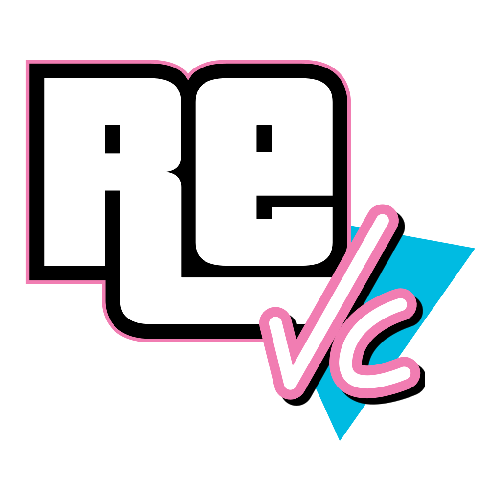

# reVC-PS3

**reVC (GTA Vice City) for the PlayStation 3**, as homebrew built with PSL1GHT.

reVC is the reverse-engineered source code of GTA Vice City. This port runs
it natively on the PS3, with a hardware renderer on the RSX (a PS3 backend
for librw), DualShock 3 controls in the PS2 style, and the game's data read
from your own PC copy. It is the sibling of
[re3-PS3](https://github.com/stingziz0u/re3-PS3) (GTA III) and shares its
PS3 layer.

> **Status: 1.7 alpha.** Every mission script of the game, the odd jobs, the
> collectibles, a flight over the whole map, saving/loading, vehicles and
> garages have been run through the automatic test on real hardware without
> crashes, and the game has been played to 100% on a real PS3. Expect bugs
> anyway and please report them with the log (see
> [Troubleshooting](#troubleshooting)).
> Only tested on real consoles, not on RPCS3.
>
>
> **Known issues:**
> - A freeze after crashing a bike at high speed has been reported. 1.2 and
>   1.3 alpha have fixes for what could cause it (the audio no longer makes
>   the game wait for the disk, the world's sector loops can't run away on
>   bad coordinates, deleted objects are taken out of the physics list), but
>   it hasn't been confirmed fixed.
> - A crash in the audio during *Cabmageddon*, after 2.5 hours of play, not
>   seen again in a shorter session. 1.5 alpha fixes a bug that writes past
>   the end of the sound queue after long sessions (found in re3-PS3, where
>   it crashed in the same place), likely its cause, but it hasn't been
>   confirmed fixed.
>
> If one of the crashes or freezes happens to you, please send the log.

**No game data is included.** You need a legally purchased copy of GTA Vice
City for PC. The PKG only has the program, its icon and two reVC files (the
PlayStation button icons and the controller picture of the settings page).

## What's new in 1.7

- **The rocket launcher's view over the whole screen**, as in San Andreas
  (the black frame around it is gone; the sniper rifle keeps its scope).
- **The PC intro movies** (`movies/Logo.mpg` and `movies/GTAtitles.mpg`)
  at start up, for testing: only with an empty `USRDIR/videointrotest.txt`.
  X, O or Start skips them.

From Gamer100Dev's [reVC-PS3-Optimised](https://github.com/Gamer100Dev/reVC-PS3-Optimised):

- Shadows filtered right, the headlights on the ground without the
  rectangle around the beam, the ped shadow never wraps to black at the edge
  of its range, the car lights fade smoothly, the long corona streaks
  without their square.
- The M4, Ruger and M60 aim in third person in the stairs camera zones (the
  player was left in first person mode).
- The drops and blood on the lens refract this frame, not the one before.
- The radio tunes a station 8 frames after the last press instead of 20.
- RSX safety: the waits for the RSX keep waiting instead of reusing memory
  still in use, a full vertex ring starts over instead of dropping draws,
  and damaged textures are refused.

## What's new in 1.6

The performance work of [reLCS-PS3](https://github.com/stingziz0u/reLCS-PS3)
1.1 and 1.2, brought over:

- **The Cell's SPUs at work**: the audio mixer runs on one SPU and the
  particles' sprites (smoke, sparks, explosions, rain, splashes) are built on
  another, so the PPU has that time for the game (in reLCS the mixer alone
  took up to 8 ms of the PPU per frame; 0.3 on the SPU).
- **Smoother streaming**: the game data is read on a thread of its own (the
  game no longer stops to wait for the disk when a new area or car loads),
  true colour textures go straight into the PS3's textures and are finished
  by the texture thread on the PPU's second hardware thread, and the radio,
  music and mission audio changes are opened by the audio stream thread.
- **Faster collision**: a first pass with AltiVec over the triangles'
  bounding boxes skips the exact tests that can't hit.
- The game's busiest code (collision, physics, entities, animation, the
  world, the render list and the RSX pipelines) is built with `-O3`.
- **The log is off by default**: nothing is written to the disk while you
  play. An empty `USRDIR/logson.txt` turns it on (see
  [Troubleshooting](#troubleshooting)).

Fixes:

- **No more square car lights**: the white boxes drawn at every car's
  headlights and tail lights are gone, as in reLCS-PS3 (the coronas and the
  light on the road still are; traffic lights and sirens are unchanged).
- **Drops on the screen last as they should**: the rain, splash and hydrant
  water drops and the chainsaw's blood drops on the screen were cut off after
  2 seconds (the game gives them more time with a counter shared by all the
  drops, so with several on the screen only one got it, and the blood never
  did). Each drop now gets its own, runs down the screen and dries up at the
  end instead of vanishing (up to about 9 seconds for water, 6 for blood),
  the same at 30 and 60 fps.
- **Drops and heat haze on the screen are drawn with the camera straight or
  up**: before, only when it looked down (the RSX cut them).
- **Rain mode** for testing: an empty `USRDIR/rain.txt` and it always rains.

## Features

- Native 720p, rendered on the RSX: tiled colour/depth buffers, compressed
  depth and ZCULL. About 60 fps across the automatic test (missions, map,
  weather).
- **30 fps** by default (the rate the game was made for) or **60 fps**:
  *Options > Graphics > Frame rate*. Always in sync with the TV (no tearing).
- PS2-style controls (Vice City's PS2 setup) with lock-on aiming, pad setups,
  inverted look, free camera, third and first person sensitivity, 20% to
  200% in steps of 5 and stick dead zones, 5% to 70% (30% the game's
  own; the right one is also where the camera starts turning), in
  *Controller setup > Gamepad settings > Stick settings*; vibration in
  *Gamepad settings*. Pressure-sensitive accelerator and brake, as on the
  PS2 (DualShock 3).
  PlayStation buttons in the on-screen help.
- The pause menu **map**: L1 shows the legend, X sets a waypoint.
- **Collectibles on the map** (*Display > Hidden packages / Rampages / Unique
  jumps / Store robberies on map*, each off by default): hidden packages in
  lime green, rampages in blood red, unique jumps (at the take-off) in orange
  and the stores to rob in purple, on the radar (the nearest one at its edge
  when none is in range) and the pause menu map. One you pick up, pass, jump
  or knock off disappears. The jumps and stores come from the original
  `main.scm`: with a modified one they aren't shown.
- **Car spawner** (for testing, off unless there is a file named
  `carspawner.txt` in `USRDIR`, any content): L3 + R3 together on foot. The
  vehicle shows as "ID: name" over the subtitles; Left/Right go one by one,
  L1/R1 by 10 (hold to scroll), X puts you in it, O closes. Boats go on the
  water in front of you (up to 30 m). Trains, the police helicopter, the
  planes you can't fly and the RC toys aren't in the list.
- **Rain mode** (for testing, off unless there is a file named `rain.txt`
  in `USRDIR`, any content): it always rains, missions included.
- All the radio stations, and the **MP3 player** station: put `.mp3` files
  in `USRDIR/mp3`.
- **Skins**: put `.bmp` skins in `USRDIR/skins`, choose them in *Player setup*.
- *Display > Screen size* for overscan, FPS counter (*Graphics > Show FPS*).
- *Options > Graphics*:
  - **Mipmaps**: textures that come without smaller versions get them (less
    shimmering in the distance). They are made as textures load: restart
    the game (or travel) for all of them. Uses more video memory.
  - **Texture filtering**: Default (the game's own), Bilinear, Trilinear,
    Anisotropic 2x to 16x (sharper ground and roads at an angle). With
    Mipmaps off, only the textures that have them in their TXD use them.
  - **Antialiasing**: Off or FXAA (smoother edges, a filter over the
    finished picture: ~2 ms of GPU time and 7 MB of video memory at 720p).
  All three are off/default unless you choose them.
- DXT textures (most of the PC game's) stay compressed in video memory and
  the RSX reads them as they are: 4 times less VRAM than converted, and
  nothing to convert when an area streams in. Mip levels made on the CPU use
  AltiVec.
- Settings saved in `USRDIR` (`reVC.ini`, `gta_vc.set`), saves in
  `USRDIR/userfiles`. Saves are in the PS3's format: PC saves can't be
  loaded, and the other way round.

## Changes from the original

The PS2/PC game was tuned for the PS2's memory: a few missions are hard
for that reason alone. reVC-PS3 changes these (everything else plays as
the original):

- **Vehicle rampages** (blow up N cars of a kind): while one runs, the
  traffic limits are lifted and the cars of the rampage are asked for, so
  enough of them come.
- ***Messing with the Man*** (the bikers' chaos mission): the same traffic
  as a rampage, and the chaos meter fills 75% faster (the original is slow
  enough that players look for exploits to finish it).
- ***Vigilante*** / ***Brown Thunder***: making room for a new criminal no
  longer deletes the previous criminal's car under the mission script (the
  criminals stopped appearing and the mission failed).
- **Horn taps**: a tap of L3 shorter than 250 ms switches the sirens and the
  Mr Whoopee jingle (*Distribution*), a longer press honks. The original
  only took presses of 1-3 frames, too short at 60 fps.
- **Stuck in the air**: when the player is held in the air between objects
  (crates) for a while, he is put on top of what is under him, or back
  where he last stood.

## Installation

1. Install `revc-ps3-1.6-alpha.pkg` on a PS3 with homebrew support (CFW or
   HEN), e.g. copy it by FTP and install it with the package manager. It
   appears in the XMB as **reVC**.
2. The PKG creates `/dev_hdd0/game/REVCPS300/USRDIR` with these empty
   folders. From your GTA Vice City PC installation, copy into them (by FTP):

   | Folder  | Contents                                   |
   |---------|--------------------------------------------|
   | `anim`  | the PC game's `anim` folder                |
   | `audio` | the PC game's `audio` folder (big: the radio stations) |
   | `data`  | the PC game's `data` folder                |
   | `models`| the PC game's `models` folder (keep the two reVC `.txd` already there) |
   | `text`  | the PC game's `text` folder                |
   | `txd`   | the PC game's `txd` folder (loading screens) |
   | `mp3`   | optional: your own music                   |
   | `skins` | optional: player skins (`.bmp`)            |

   The `movies` and `mss` folders of the PC game aren't needed. Keep the
   folder names lowercase, exactly as above.
3. Start **reVC** from the XMB.

## Mods

**`USRDIR/mods`**, like a mod loader on the PC: a file put there (in any
subfolder, any letter case) is used instead of the game's file with the same
name, whether that one is loose (`hud.txd`, `handling.cfg`, `main.scm`...)
or inside `gta3.img` (`weapons.txd`, `infernus.dff`...). Nothing has to be
rebuilt: take a mod's files out of its folder or delete them and the
original ones are back. If two files have the same name, the one whose path
comes first in alphabetical order is used. The log lists every file
replaced (`[mods]` lines). Files in `USRDIR` itself (`reVC.ini`, settings,
logs), `userfiles` and `mp3` are never replaced. `.img` files inside `mods`
aren't read: take the files out of them with an IMG tool.

Anything made for the PC version of GTA Vice City as data files works:

- TXD textures (in `mods`, loose in `models`/`txd`, or inside `gta3.img`
  with an IMG tool on the PC, then copy `gta3.img` and `gta3.dir`): HD
  loading screens, HUD, fonts, vehicles, peds, buildings. All PC formats are
  read (palettized, 16/32 bit, DXT1/3/5).
- DFF models in GTA Vice City PC format, in `mods` or inside `gta3.img`.
- Data files (`handling.cfg`, `carcols.dat`, `timecyc.dat`, `gta_vc.dat`...)
  and a modified `main.scm`.

Limits: on the PS3 DXT textures (power of two sizes) stay compressed, as on
the PC, and every other texture takes 4 bytes per pixel (uncompressed) in
the RSX's 216 MB. When video memory runs out (a pack of uncompressed HD
textures, e.g. a 64-tile HD map), the textures that don't fit any more are
compressed into DXT as they load (4 to 8 times smaller, a little less
sharp) instead of turning white; for the best quality, use DXT textures in
the pack. The largest texture size is 4096×4096. Code mods (CLEO, ASI,
plugins that patch the executable) and unconverted assets from other games
or platforms don't work.

## Troubleshooting

- **The log is off by default** (nothing is written to the disk while you
  play). To turn it on, create an empty `USRDIR/logson.txt`; the log is then
  `USRDIR/revc-ps3.log` (the previous one: `revc-ps3.old.log`). Send it with any
  report: it says what the game was doing when it crashed. The tests below
  need it on.
- A black screen at start: create an empty `USRDIR/notiles.txt` (turns off
  the tiled buffers), and report it.
- A texture that looks wrong: create an empty `USRDIR/nodxt.txt` (DXT
  textures converted on the CPU, as before), and report it. If that
  isn't it, an empty `USRDIR/notexthread.txt` converts the textures on the
  game's own thread again (they are converted on a second PPU thread);
  `USRDIR/novmx.txt` makes the mip levels without AltiVec; and
  `USRDIR/dxt32.txt` keeps converted DXT1 textures in 32 bits instead of 16.
- Something not loading, or loading late: an empty `USRDIR/nocdthread.txt`
  reads the game data on the game's own thread again, and
  `USRDIR/notxddirect.txt` converts the TXDs' true colour textures the old
  way. Radio, music or mission audio that misbehaves:
  `USRDIR/nostreamasync.txt` opens the streams on the game's thread again.
  Collisions that look wrong: `USRDIR/novmxcol.txt` turns off the AltiVec
  collision broadphase.
- Sound or particles that look or sound wrong: an empty
  `USRDIR/nospuaudio.txt` mixes the audio on the PPU again,
  `USRDIR/nospuparticles.txt` builds the particles on the PPU again, and
  `USRDIR/spuparticles_ram.txt` keeps them on the SPU but has it write to
  main memory (the PPU copies them for the RSX). Report which one changes
  it, with the log.
- The intro movies: an empty `USRDIR/videointrotest.txt` plays them at
  start up (they need the `movies` folder of the PC game); if they don't
  show, send the log.
- `USRDIR/autotest.txt` runs an automatic test while you watch (load a save
  in a safehouse, with no mission running, and walk out: it starts 10 s
  after the player is outdoors, with a countdown on screen). One line in it chooses
  the test: nothing (weather, a flight over the map, save/load, a car, a
  bike, a helicopter and a boat, side missions, garages; `loops=N` repeats
  it), `mode=full` (every mission 30 s — `secs=N`, `from=N`, `to=N` —
  odd jobs, rampage, collectibles; it changes the game's progress and money,
  don't save after it; if the game dies in a mission, the next start goes on
  after it, `resume=0` turns that off), `mode=gpu` (GPU benchmark),
  `mode=rain`, `mode=leak`, `mode=stress` (the heaviest loads in Little
  Haiti: rain, hurricane, night, traffic, a riot with armed peds, cars blown
  up, wanted level 6 in a tank, all of it at once; then flights in the rain;
  about 7 minutes), `mode=tankstress` (you drive a tank with its doors
  locked and wanted level 6 kept up, 5 minutes; for performance logs of
  the chaos). The file is renamed to `autotest.done.txt` when the test
  ends.

## Building

On Linux or WSL (Ubuntu):

1. Install the PS3 toolchain and PSL1GHT (https://github.com/ps3dev/ps3toolchain),
   which ends up in `/usr/local/ps3dev`.
2. Build:

   ```sh
   git clone https://github.com/stingziz0u/reVC-PS3.git
   cd reVC-PS3
   export PS3DEV=/usr/local/ps3dev PSL1GHT=/usr/local/ps3dev
   export PATH=$PS3DEV/bin:$PS3DEV/ppu/bin:$PATH
   make -C ps3 -j$(nproc)
   make -C ps3 verify
   ```

   The result is `ps3/revc-ps3-1.6-alpha.pkg`.

Other targets: `make -C ps3 DEBUG=1` (debug build with asserts),
`make -C ps3 FTRACE=1` (function trace of peds, weapons, collision, HUD,
radar... dumped to the log at a crash), `make -C ps3 STAGE=1` (headless test
build: loads the game without video, audio or pad, everything to the log),
`make -C ps3 crash LOG=<revc-ps3.log>` (the crash lines of a log as function
names, for the build that made it), `make -C ps3 clean`.

The RSX shaders are in the tree already compiled
(`vendor/librw/src/ps3/ps3shaders.h`). To change them you need NVIDIA's `cgc`
and PSL1GHT's `cgcomp` with `cgcomp-relative-constants.patch`; see
`vendor/librw/src/ps3/shaders/build_shaders.sh`.

### Where things are

- `ps3/` — Makefile, PKG icon, patch level, `tools/crashaddr.py`.
- `src/skel/ps3/` — platform layer: main loop, file system, pad, log, test.
- `src/audio/sampman_ps3.cpp` — audio (software mixer on libaudio, the radio's ADF, MP3/WAV streams).
- `vendor/librw/src/ps3/` — librw's RSX backend: VRAM, rasters, pipelines, shaders.
- `src/core/config.h` (`__PS3__` section) — what the PS3 build turns on and off.

## Credits

- The [re3 team](https://github.com/GTAmodding/re3) for reVC, and aap for
  [librw](https://github.com/aap/librw).
- The [ps3dev](https://github.com/ps3dev) people for ps3toolchain and PSL1GHT.
- lieff for [minimp3](https://github.com/lieff/minimp3).
- phoboslab for [pl_mpeg](https://github.com/phoboslab/pl_mpeg) (the intro
  movies).
- Gamer100Dev for the fixes of
  [reVC-PS3-Optimised](https://github.com/Gamer100Dev/reVC-PS3-Optimised).

The original reVC README is kept as [README.reVC.md](README.reVC.md).

## License

See [LICENSE](LICENSE). Grand Theft Auto: Vice City is © Rockstar Games /
Take-Two Interactive. This project is not affiliated with or endorsed by
Rockstar Games, Take-Two Interactive or Sony Interactive Entertainment.

## AI disclosure

This project's code was written collaboratively with Claude (Anthropic),
working through this port with me in real time over many sessions. Every
bit of testing and debugging was done by me on real hardware.
